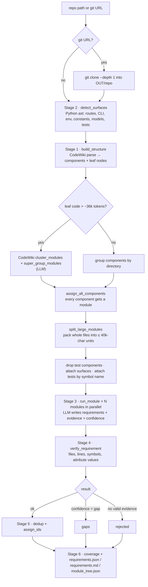

# code2req

code2req recovers natural-language requirements from an existing codebase. You point it at a repository and get a list of statements such as *"The API shall reject cart item additions with an HTTP 422 status code … if the requested quantity is less than 1."*

- **Traceable:** every requirement cites the exact files and lines it came from.
- **Verified:** citations are checked by deterministic code before a requirement is kept.
- **Graded:** each requirement says whether a test confirms it, it was only read from the code, or it is intended but not implemented.

The output uses the same JSON shape as SysModeler's docreq document pipeline, so the requirements can later be rendered into SysML the same way requirements from uploaded documents are.

---

## Contents

1. [Quick start](#1-quick-start)
2. [The idea in one paragraph](#2-the-idea-in-one-paragraph)
3. [What was taken from each public project](#3-what-was-taken-from-each-public-project)
4. [End-to-end flow](#4-end-to-end-flow)
5. [Stage 1: Structure (CodeWiki)](#5-stage-1-structure-codewiki)
6. [Stage 2: Surfaces (deterministic detectors)](#6-stage-2-surfaces-deterministic-detectors)
7. [Stage 3: Module agents (LLM)](#7-stage-3-module-agents-llm)
8. [Stage 4: Verification](#8-stage-4-verification)
9. [Stage 5: Dedup and IDs](#9-stage-5-dedup-and-ids)
10. [Stage 6: Coverage and output files](#10-stage-6-coverage-and-output-files)
11. [The LLM layer: docreq's model chain](#11-the-llm-layer-docreqs-model-chain)
12. [Output format reference](#12-output-format-reference)
13. [Configuration and CLI](#13-configuration-and-cli)
14. [Storage: is a graph database needed?](#14-storage-is-a-graph-database-needed)
15. [Project layout](#15-project-layout)
16. [Tests](#16-tests)
17. [Measured results](#17-measured-results)
18. [Limitations and roadmap](#18-limitations-and-roadmap)
19. [Licenses](#19-licenses)

---

## 1. Quick start

```bash
cd "d:/AI work/code2req"
python -m venv .venv
.venv/Scripts/pip install -e ".[dev]"        # Windows layout; use .venv/bin on Linux/macOS

# Use the sysmodeler-backend-ai keys directly ...
.venv/Scripts/code2req analyze <repo path or git URL> --env-file "d:/AI work/sysmodeler-backend-ai/.env" --out out/myrun
# ... or put the keys in ./.env, which is loaded automatically
.venv/Scripts/code2req analyze <repo path or git URL> --out out/myrun
```

Open `out/myrun/requirements.md` to review the requirements. `out/myrun/requirements.json` is the machine-readable result.

### Web UI

```bash
.venv/Scripts/code2req serve --env-file "d:/AI work/sysmodeler-backend-ai/.env"   # then open http://127.0.0.1:8765
```

In the browser you can:

- paste a folder path or git URL and start a run, with live progress (stage, modules done) and the log;
- browse requirements, gaps, rejected claims, uncovered surfaces and stats, filtered by text, confidence, type, section or review state;
- click any `file:lines` citation to open the cited code with those lines highlighted;
- mark each requirement **✓ Correct / ✗ Wrong / ? Unsure** with a note (saved in `review.json`), and export the JSON with reviews attached.

Runs are stored in `out/web/<run-id>/`. One run executes at a time. The server binds to `127.0.0.1` only, because it reads local folders and runs `git clone`.

Run the tests with `.venv/Scripts/python -m pytest`. They use a fake LLM and need no network or keys.

---

## 2. The idea in one paragraph

An LLM that reads code and writes requirements on its own produces plausible but unreliable output. A 2026 study ([arXiv 2606.25550](https://arxiv.org/abs/2606.25550)) concluded exactly this and recommended human supervision. code2req therefore splits the work the same way docreq does for documents: **the LLM proposes, deterministic code checks.**

- Tree-sitter parsing (through CodeWiki) gives exact code structure and line ranges.
- Plain Python detectors list what the system exposes: routes, CLI commands, env vars, limits and tests.
- The LLM reads one module at a time and writes requirements. Each requirement must cite file, lines and symbol.
- A verifier rejects any requirement whose citations don't point at real code containing the cited symbol. It also drops numeric limits that don't appear in the cited code.

What remains is a requirement set where every line can be clicked through to its source.

---

## 3. What was taken from each public project

| Project | License | What code2req uses | How |
|---|---|---|---|
| **[CodeWiki](https://github.com/FSoft-AI4Code/CodeWiki)** (FSoft-AI4Code, ACL 2026) | MIT | Code parsing, dependency graph, module clustering | **Vendored source, unmodified**, in `vendor/codewiki/`, imported as a library |
| **[Reversa](https://github.com/sandeco/reversa)** (sandeco) | MIT | The confirmed / inferred / gap confidence tagging, and traceability for every claim | **Ideas only.** No code is copied |
| **docreq** (`sysmodeler-backend-ai/app/chatbot/tools/docreq`, internal) | internal | Output schema, prompt rules for naming and attributes, LLM model chain and retry rules, truncated-JSON recovery, dedup keys | **Ported to Python** |
| **[LiteLLM](https://github.com/BerriAI/litellm)** | MIT | Gemini calls, and any single model with `--model` | pip dependency |
| **[openai-python](https://github.com/openai/openai-python)** | Apache-2.0 | Azure OpenAI Responses API calls | pip dependency |
| **tree-sitter** and its grammars | MIT | Parsers used by CodeWiki | pip dependency |
| **[GitNexus](https://landscape.jimmysong.io/projects/gitnexus/)** | n/a | Evaluated, not used | Kept as a fallback if CodeWiki's graph proves too weak |
| **[arXiv 2606.25550](https://arxiv.org/abs/2606.25550)** | paper | Design constraint: never trust unverified LLM requirements | Led to the verifier and the evidence field |

### 3.1 CodeWiki in detail

CodeWiki turns a repository into a documentation wiki. It parses the code with tree-sitter (16 languages), builds a dependency graph, clusters the code into a module tree with an LLM, and runs one documentation agent per module. code2req uses **only its first two stages**:

| CodeWiki piece | File in `vendor/codewiki/codewiki/src/` | Used? | What it gives code2req |
|---|---|---|---|
| `DependencyGraphBuilder.build_dependency_graph()` | `be/dependency_analyzer/dependency_graphs_builder.py` | **Yes** | Every function, class, struct or method ("component") with `id`, `name`, `relative_path`, `start_line`, `end_line`, `source_code` and `depends_on` (call/use edges), plus the list of **leaf nodes**: the entry-point components that nothing else depends on |
| Per-language analyzers (Python, Java, JS/TS, Go, C/C++, C#, Kotlin, PHP, Ruby, Scala, Rust, Dart, Zig, Vue) | `be/dependency_analyzer/analyzers/*.py` | **Yes** (indirectly) | Language-aware parsing and call resolution |
| `cluster_modules()` and `super_group_modules()` | `be/cluster_modules.py` | **Yes** | An LLM groups the leaf components into a module tree: `{name: {components, children}}`. Below about 36k tokens of leaf code, CodeWiki skips clustering and returns `{}` |
| `Config` dataclass | `config.py` | **Yes** | Built by code2req with its own values (see §5) |
| Documentation agents, doc writer, prompts | `be/documentation_generator.py`, `be/prompt_template.py`, `be/agent_tools/` | No | Replaced by code2req's module agent |
| caw subscription backend, MCP server, web app, HTML viewer, Mermaid validation | `be/caw_*.py`, `mcp/`, `fe/` | No | Not needed |

Its heavy optional pieces are imported lazily inside functions: the git-only `coding-agent-wrapper` package, and the Mermaid parser that needs Node.js. So code2req installs only a slim dependency subset (see `pyproject.toml`) and does **not** `pip install` CodeWiki. `code2req/structure.py` adds `vendor/codewiki` to `sys.path` at import time.

### 3.2 Reversa in detail

Reversa is a set of prompts and agents for coding assistants such as Claude Code that reverse-engineers legacy systems into specifications. It is not a library, so nothing is executed from it. Two ideas were adopted:

- **Confidence per statement.** Reversa marks every statement 🟢 CONFIRMED, 🟡 INFERRED or 🔴 GAP. code2req uses the same three levels, with a precise, checkable meaning:
  - `confirmed`: a test asserts the behaviour, and a test file is cited.
  - `inferred`: read from the implementation.
  - `gap`: the code signals the behaviour is intended but not implemented (TODO, stub, `NotImplementedError`).
- **Traceability.** Every statement points back to code. In code2req this is the mandatory `evidence` list.

### 3.3 docreq in detail

docreq is SysModeler's pipeline that turns uploaded documents into requirements and SysML. code2req mirrors it on purpose, so both feed the same downstream code:

| docreq source (Go) | code2req equivalent (Python) |
|---|---|
| `types.go` → `flatRequirement`, `llmAttribute`, `llmActor` JSON tags | `schema.py` → `FlatRequirement`, `Attribute`, `Actor`, with identical JSON keys |
| `prompts.go` → `compactNamingRulesBlock`, `compactAttributeRulesBlock`, `claimKeyRulesBlock` | `prompts.py` → `NAMING_RULES`, `ATTRIBUTE_RULES`, CLAIM KEY rule, reworded for code |
| `models.go` → `extractionModels()`, retry loop, `backoff()`, `maxAttemptDuration`, `recoverPartialJSON()` | `llm.py` → `docreq_models()`, `FallbackLLM.complete()`, `recover_partial_json()` |
| `providers/gemini/models.go`, `providers/openai/models.go` | The same model IDs in `docreq_models()` |
| `providers/openai/generate.go` Azure Responses URL logic | `llm._azure_base_url()` |
| `pass1_extract.go` `normalizeRequirementText`, `pass1_claim_dedup.go` claim key | `dedup.py` → `normalize_text()`, `claim_key()` |
| `pass1_coverage.go` "check the LLM against local text" philosophy | `verify.py`, which checks the LLM against the real source files |

---

## 4. End-to-end flow



The orchestrator is `code2req/pipeline.py` → `run()`. Surface detection runs first because it is cheap and needs no CodeWiki state. The numbered stages below follow the logical order.

---

## 5. Stage 1: Structure (CodeWiki)

**File:** `code2req/structure.py` → `build_structure()`

### 5.1 Parsing

code2req builds a CodeWiki `Config` itself (`_codewiki_config`):

| Field | Value | Why |
|---|---|---|
| `repo_path` | the target repo | |
| `output_dir`, `dependency_graph_dir` | `OUT/temp`, `OUT/temp/dependency_graphs` | CodeWiki writes `<repo>_dependency_graph.json` here (useful for debugging) |
| `docs_dir` | `OUT` | Required field; CodeWiki docs are never generated |
| `max_depth` | `2` | Module tree depth for clustering |
| `main_model`, `cluster_model` | label of the LLM in use | Only used by CodeWiki for logging; calls go through code2req's completer |
| `agent_instructions` | `{"exclude_patterns": [...]}` from `--exclude` | CodeWiki's own include/exclude mechanism |
| `artifacts_enabled` | `False` | Build/CI/Docker artifacts are not requirement sources yet |

`DependencyGraphBuilder(config).build_dependency_graph()` returns:

- `components`: a dict of CodeWiki `Node` objects (one per function, class or method).
- `leaf_nodes`: the entry-point component IDs.

CodeWiki also honours `.gitignore`.

**Path fix.** CodeWiki keeps OS separators in `relative_path` (`app\api.py` on Windows). code2req converts them to `/` immediately, because surfaces, evidence and the verifier all use forward slashes.

### 5.2 Modules

1. **Clustering.** `cluster_modules()` receives a `completer` that routes CodeWiki's prompt through code2req's LLM (`FallbackLLM` by default). It does a real LLM call only when the leaf components exceed CodeWiki's threshold (`max_token_per_module`, default 36,369 tokens). Then `super_group_modules()` groups top-level modules when there are many. The leaf modules of the resulting tree become code2req `Module`s; `section` is the tree path joined with ` > `.
2. **Small repos.** When CodeWiki skips clustering and returns `{}`, components are grouped by their directory. Components at the repo root get the repo's folder name (e.g. `docreq`) instead of `(root)`.
3. **Nothing left behind** (`assign_all_components`). CodeWiki's module tree lists only *leaf* components. Every other component is attached to the module that already owns another component of the same file. Failing that, it goes to a per-directory module. So all parsed code reaches an agent.
4. **File-aligned packing** (`split_large_modules`, limit `--max-module-chars`, default **40,000** characters of source):
   - A module under the limit is kept whole.
   - A larger module is cut **only at file boundaries**: whole files are packed together until the next file would overflow.
   - A single file larger than the limit is split by component into `file (part 1)`, `file (part 2)`, …
   - Each unit is named after its files (`pass1_extract, pass1_jobs`, or `headings +4 more` when there are more than 3), and the name becomes the last section segment.

   *Why 40k and file-aligned?* On the docreq package, three 120k-character slices produced about 20 requirements each, whatever their size. Nine file-aligned units of about 40k produced 184 requirements for the same input tokens (§17).

### 5.3 Preparing module inputs (`pipeline.py`)

- **Test code is not module code.** `drop_test_components` removes components from test files (`is_test_path`: under `tests/`, `test/`, `__tests__/` or `spec/`; or named `test_*`, `*_test.py`, `*_test.go`, `*.test.*`, `*.spec.*`, `conftest.py`). Modules left empty are dropped.
- **Surfaces** (§6) go to the module whose component contains the surface's line. If none does, they go to the first module holding a component of that file (`assign_surfaces`). Test surfaces are handled separately.
- **Tests are attached by symbol name** (`assign_tests`):
  - Each test function's source (first 60 lines) is scanned for names of the module's components. Only names of 4+ characters not starting with `_` count.
  - A test that mentions a module's function is attached to that module, up to 12 tests per module.
  - This is how the agent can mark a requirement `confirmed`.

### 5.1 Python relationship graph

**Files:** `code2req/pygraph/` (`source.py`, `resolve.py`, `comments.py`, `ownership.py`, `build.py`), called from `build_structure`

CodeWiki's `repo_dependency_graph.json` holds functions, methods and classes, with call edges. For Python files this pass adds every other line of code as a node and links the nodes. It only changes the graph file and the `depends_on` sets in memory; the module agents and prompts are unchanged.

| New node | What it is |
|---|---|
| `docstring`, `imports`, `script_block`, `main_script` | Module-level code between the functions. Consecutive statements of one kind form one node (cut at 150 lines) |
| `variable`, `constant` | One node per module-level assignment, with its `value`. `constant` when every name is UPPER_CASE |
| `class_attribute`, `instance_attribute` | `x = 5` in a class body; `self.x = ...` in any method (the first assignment defines the node, `writes_at` lists the rest) |
| `function`, `method`, `class` with `synthetic: true` | Defs CodeWiki did not list, such as nested functions |
| `comment_block` | Comment-only lines that sit outside every node and not directly above one. `describes` names the node just below |
| `module` | One per file. `depends_on` lists the repo modules it imports, `children` lists its nodes |

**Links.** `depends_on` holds ids of real nodes: a function lists the variables, class and instance attributes, functions and classes it uses (`self.x`, `Base.LEVEL`, `config.MAX_ITEMS`, `from app.config import limit`, base-class attributes included). Things outside the repo stay strings, such as `import:requests.get`. `reads` and `writes` split out the variables and attributes it reads and assigns (`x += 1` counts as both). `unresolved_attributes` lists `self.x` names that no class in the repo defines. Python builtins are not listed yet.

**Comments.** A comment inside a node is already part of its `source_code`. A comment block directly above a node (no blank line between) becomes that node's `leading_comments`. Entries carry `tag` for `TODO`, `FIXME`, `NOTE`, `HACK` and `XXX`, and `pragma` for `noqa` and `type:` comments.

**Line ownership.** Every non-blank line of a Python file should belong to a node. `<repo>_line_ownership.json` next to the graph lists the lines that do not, and compares the count with CodeWiki alone. The CLI prints the totals after a run.

---

## 6. Stage 2: Surfaces (deterministic detectors)

**Files:** `code2req/surfaces/__init__.py` (repo walk), `code2req/surfaces/python.py` (detector)

A *surface* is something the system exposes or enforces that a requirement should cover. Detection uses Python's own `ast` module: exact, no LLM, no extra dependency. The walk skips `.git`, `.venv`, `venv`, `node_modules`, `__pycache__`, `dist`, `build`, `vendor`, `.tox`, caches, `site-packages`, and hidden directories.

| Kind | Detected when | `name` / `detail` |
|---|---|---|
| `http_route` | Decorator `@<x>.get/post/put/patch/delete/head/options/websocket(...)` (FastAPI, APIRouter); `@<x>.route(..., methods=[...])` (Flask; default GET) | `"POST /cart/items"` / handler function name |
| `cli_command` | Decorator `@<x>.command(...)` or `@<x>.group(...)` (click, typer) | `name=` argument or function name / decorator |
| `env_var` | `os.getenv("X")`, `getenv("X")`, `os.environ.get("X")`, `os.environ["X"]` | variable name (once per file) |
| `constant` | Module-level `UPPER_CASE = <int or float>` (including negative), not booleans | name / literal value, e.g. `"50"` |
| `model` | Class based on `BaseModel`, `Base`, `Model`, `SQLModel`, `Document`, `TypedDict`, or decorated `@dataclass` | class name / bases |
| `test` | Function `test*` in a test file | test name / `"N assert(s)"` |

Surfaces have three jobs:

1. They are listed in the module prompt as anchors ("cover every surface").
2. Constants feed the verifier's value check (§8).
3. They are the denominator of the **surface coverage** metric (§10).

Only Python has detectors so far. Other languages still get requirements from the module agent, but no surfaces or coverage numbers.

---

## 7. Stage 3: Module agents (LLM)

**Files:** `code2req/agents/module_agent.py`, `code2req/prompts.py`

There is one LLM call per module, run in a thread pool (`--workers`, default 4). A module that fails after all retries is logged and skipped; the run continues.

### 7.1 What the model sees (`build_module_prompt`)

```
MODULE: docreq > pipeline, prepare

SURFACES:
- [http_route] POST /cart/items (add_item) - app/api.py:24
...

SOURCE CODE:

### app/api.py :: validate_quantity (lines 18-20)
18 | def validate_quantity(quantity: int) -> None:
19 |     if quantity < 1:
20 |         raise HTTPException(status_code=422, detail="quantity must be positive")
...

TESTS THAT EXERCISE THIS MODULE:

### tests/test_api.py :: test_validate_quantity_rejects_zero (lines 7-10)
 7 | def test_validate_quantity_rejects_zero():
...
```

Every line carries its **real line number** in the file. That is what makes citations checkable.

**Whole files, not just functions.** CodeWiki only extracts functions, methods and classes. Sending only those hid every package-level constant and every file made only of declarations. On docreq, `prompts.go` (the extraction rules) never reached the model, and 25 constants such as `coverageWordOverlap = 0.85` appeared as bare names. So `render_code` sends:

- **A file wholly inside a module:** the whole file.
- **A file split across modules:** each part gets its components plus the file's **top-level declarations** (imports, consts, vars, types).
- **Files with no components at all** (`attach_declaration_files`): they join the smallest module covering their directory, or get their own. Larger ones (over 3× the module size) are skipped as probably generated.

### 7.4 Follow-up for uncited functions

This step works like docreq's backfill. After the first pass is verified, every function or method of at least 3 lines whose range no kept requirement cites goes back to the model in one call per module (`run_followup`, `FOLLOWUP_SYSTEM`). The call includes the requirements already written for that module, so it doesn't repeat them. For each function the model must either:

- write requirements for behaviour not yet stated, or
- list the function under `internal`, meaning it's a pure helper.

Follow-up requirements go through the same verification. `stats.function_coverage` reports:

- `total`, `cited_first_pass`, `cited` and `internal_helpers`;
- `ratio`: cited ÷ total;
- `accounted_ratio`: cited plus internal, ÷ total;
- the remaining `uncited` functions.

`internal` is the model's own judgement and is not verified. Turn the step off with `--no-followup`.

### 7.2 What the model is told (`MODULE_SYSTEM`)

- **What to write:**
  - One requirement per distinct, testable behaviour, rule, limit, interface or data constraint, phrased "The system shall …" (or a narrower subject: "The API shall …").
  - Describe observable behaviour: inputs accepted or rejected, outputs, state changes, persisted data, errors, limits, security checks, integrations.
  - Name external contract details exactly: method and path, CLI names, env vars, status codes, model fields. Do not describe internals.
  - Start with the module's main responsibilities (steps, order, what it calls and writes), then specific rules.
  - **No cap** on the count, and every listed surface should be covered.
  - Do not invent behaviour. Skip logging, getters and boilerplate.
- **Evidence (mandatory):** 1–3 entries `{file, start_line, end_line, symbol}`, using only line numbers shown.
- **Confidence:** `confirmed` (a shown test asserts it, and the test is cited), `inferred`, or `gap`.
- **Type:** `functional | performance | interface | safety | constraint | design`, with a one-line definition of each.
- **docreq rules carried over:**
  - Naming: `canonical_name` is 2–6 Title Case words, plus `group_id`, `subject_name` and `actors`.
  - Attributes: lowerCamelCase name, operator, value in SI base units, unit literal, ISQ type; a range is two entries.
  - Claim key: `claim_attribute` / `claim_value` in snake_case.
- **Output:** JSON `{"requirements": [...]}` only.

### 7.3 Parsing the reply (`parse_requirements`)

The reply is parsed with `parse_json_object`, which tolerates ```` ``` ```` fences, leading prose and bare arrays. Each item is then repaired and validated:

- An `id` from the model is discarded; IDs are assigned later.
- `section` and `module` are set from the module, never from the model.
- An unknown `type` becomes `functional`; an unknown `confidence` becomes `inferred`.
- Items with empty text, and items that fail pydantic validation, are dropped with a log line.

---

## 8. Stage 4: Verification

**File:** `code2req/verify.py` → `verify_requirement()`. This step is fully deterministic.

The verifier reads files through a `FileCache` that also holds a small code index:

- `symbols`: the line range and name of every CodeWiki component, per file.
- `constants`: the value of each numeric constant surface.

### 8.1 Each evidence entry (`check_evidence`)

1. **Path:** the path is normalized (forward slashes, a leading `./` removed, absolute paths made repo-relative). It must resolve **inside** the repo; paths that escape are rejected.
2. **Lines:** `start_line` must be within the file. `end_line` is clamped to the file length, and raised to `start_line` if smaller.
3. **Symbol:** if a `symbol` is given (the last segment of `pkg.func` is used), it must appear as a whole word either:
   - in the cited lines ±2 lines (`SYMBOL_SLACK`), **or**
   - as the name of a component whose range encloses the cited lines, also without its receiver: CodeWiki names a Go method `docxCursor.emitCurrentPara`, and the model cites `emitCurrentPara`. **or**
   - on the **nearest top-level declaration above** the cited lines (`declared_above`). This handles citations deep inside a long constant, such as a prompt string, or inside a method body.

   Both fallbacks fixed real false rejections. Citing lines 28–29 of `add_item` matches its `def` on line 24. Citing `prompts.go:67` inside `extractionSystemPrompt` matches the `var extractionSystemPrompt =` line above it.

Each entry records `ok` and, when it fails, a `note`: `file not found`, `start_line outside file`, or `symbol 'X' not in cited lines`.

### 8.2 Each requirement

| Rule | Effect |
|---|---|
| At least one evidence entry passes | Kept. Failed entries are removed. `source_file` = first valid file |
| No evidence passes | **Rejected**: listed under `rejected` with its notes |
| `confidence: confirmed` but no valid evidence in a test file | Downgraded to `inferred` |
| `confidence: gap` | Kept separately under `gaps` |
| Attribute whose value is not in the cited code | The attribute is dropped; the requirement stays |

**Attribute value check.** All numbers in the cited lines are collected (including `1_000`, decimals and exponents). The values of any named constants mentioned in those lines are added, so `len(cart) >= MAX_CART_ITEMS` verifies 50. The attribute's value must equal one of those numbers times a common unit scale: 1, 10^±3, 10^±6, 10^±2, ×60, ÷60, ×3600, ÷3600, ×1024, ×1024², ÷1024, ÷1024². For example, `SESSION_TIMEOUT_MS = 1500` verifies `1.5 [s]`.

The counts end up in `stats.verify`: checked, passed, rejected, downgraded_confirmed, evidence_failed, attributes_dropped, and reasons.

---

## 9. Stage 5: Dedup and IDs

**File:** `code2req/dedup.py`

- **Exact text:** lowercased, whitespace collapsed, trailing period removed (as in docreq `normalizeRequirementText`).
- **Claim key:** same `section` + `claim_attribute` + `claim_value` (as in docreq `claimKey`). Different sections never collide.
- **Merging:** the first requirement wins. It takes the union of both requirements' evidence and the stronger confidence (`confirmed` > `inferred` > `gap`), and the other requirement's attributes if it has none.
- **IDs:** `CODE-<SLUG>-NNN`, numbered per module. The slug is the module's first file or name, alphanumerics only, uppercase, at most 12 characters (`CODE-PIPELINE-007`). Gaps get `GAP-<SLUG>-NNN`. An empty `group_id` becomes the lowercased ID.

Requirements and gaps are deduped separately.

---

## 10. Stage 6: Coverage and output files

**Surface coverage** (`surface_coverage`): a surface counts as covered when a kept requirement's evidence overlaps its line range in the same file. Constants and env vars also count when their **name** appears in any cited lines, because code uses a constant far from where it is defined. Tests are excluded. The result has a total, a ratio, a breakdown by kind, and the list of uncovered surfaces.

Files written to `--out`:

| File | Content |
|---|---|
| `requirements.json` | Full result (§12) |
| `requirements.md` | Review report: summary, requirements grouped by section with type, confidence, `file:lines` and attributes; gaps; uncovered surfaces; rejected claims with reasons |
| `module_tree.json` | CodeWiki's module tree (`{}` when clustering was skipped) |
| `temp/dependency_graphs/*.json` | CodeWiki's dependency graph |
| `repo/` | The clone, when a git URL was given |

---

## 11. The LLM layer: docreq's model chain

**File:** `code2req/llm.py`

By default code2req uses `FallbackLLM`, a Python port of docreq's `extractionModels()` / `callExtractionLLM()`:

| # | Provider | Model | Attempts |
|---|---|---|---|
| 1 | Gemini | `gemini-3.1-pro-preview` | 3 |
| 2 | Gemini | `gemini-3.8-flash` | 3 |
| 3 | Azure OpenAI | `gpt-5.4` | 1 |
| 4 | Azure OpenAI | `gpt-5.5` | 1 |
| 5 | Azure OpenAI | `gpt-5.6-terra` | 1 |
| 6 | Gemini | `gemini-3.8-flash` | 3 |

Behaviour, matching `models.go`:

- **Timeout:** 3 minutes per attempt (`MAX_ATTEMPT_SECONDS = 180`).
- **Backoff:** 2^n seconds between attempts of the same model (2 s, then 4 s).
- **JSON check:** in JSON mode a reply must parse. A truncated reply is repaired by `recover_partial_json`: cut at the last `}` and append `]}`, as in `recoverPartialJSON`. If that fails, the next attempt or model is tried.
- **Skipping:** a model without credentials is skipped. After the whole chain fails, `RuntimeError("all models failed: …")` is raised and that module is skipped.

How each provider is called:

- **Gemini:** through LiteLLM (`gemini/<model>`, `response_format=json_object` in JSON mode).
  - **Keys:** `GEMINI_API_KEY` is used **alone** when it is set, exactly like sysmodeler-backend-ai's Go client (one key, no rotation). The comma-separated `GEMINI_API_KEYS` pool (sysmodeler-backend format) is only a fallback when it is absent. When the pool is used, its keys rotate round-robin.
  - **Invalid key or spent daily quota:** that key is **parked** for the rest of the run.
  - **Per-minute rate limit:** the next attempt waits the `retryDelay` Gemini returns, capped at 60 s, instead of 2^n s.
  - **CodeWiki's import-time `load_dotenv()` is blocked**, so a stray `code2req/.env` can't override `--env-file`.
  - Gemini's Batch API isn't used: results can take up to 24 hours, and it doesn't help when a daily quota is spent. The backend doesn't batch either; one paid key plus a few parallel calls is what keeps it reliable.
- **Azure OpenAI:** through the `openai` SDK's Responses API, with docreq's URL rule. An endpoint already containing `/openai` is used as is; otherwise `/openai/v1` is appended.
  - Sent with both `Authorization: Bearer` and `api-key` headers, and `api-version` as a query parameter.
  - Credentials: `AZURE_OPENAI_5_4_*`, `AZURE_OPENAI_5_5_*` and `AZURE_OPENAI_5_6_TERRA_*`, each with `_API_KEY`, `_ENDPOINT` and `_API_VERSION`.

`--model <litellm model string>` replaces the chain with a single LiteLLM model (3 attempts, 2^n backoff), e.g. `anthropic/<model>` or `openai/<model>`.

### 11.1 Cost in credits

**File:** `code2req/cost.py`. It computes cost the way SysModeler bills, and is ported from three places:

- **`sysmodeler-backend-ai` `providers/gemini/cost.go`:** the price table and how a call is priced.
  - Rates are per million tokens.
  - Pro has two tiers, split at a 200k-token prompt.
  - Flash uses its introductory price until 2027-01-01.
  - Input is split into new and cached tokens.
  - Output is `CandidatesTokenCount`.
- **`providers/openai/cost.go`:** the Azure GPT rates.
- **`sysmodeler-backend-api` `billing/credits.go`:** **credits = USD × 10,000**, rounded half up with exact decimal arithmetic. SysModeler sums every call made for a message and deducts once, so a whole run is treated as one message.

| Model | Input $/M | Cached input $/M | Output $/M |
|---|---|---|---|
| `gemini-3.1-pro-preview`, prompt ≤ 200k | 2.00 | 0.20 | 12.00 |
| `gemini-3.1-pro-preview`, prompt > 200k | 4.00 | 0.40 | 18.00 |
| `gemini-3.8-flash` until 2027-01-01 / after | 0.75 / 1.50 | 0.075 / 0.15 | 3.75 / 7.50 |
| `gpt-5.4` / `gpt-5.5` / `gpt-5.6-terra` | 3.75 / 7.50 / 2.00 | 0.375 / 0.75 / 0.20 | 15 / 30 / 12 |

**Thinking tokens.** Gemini reports thinking tokens (`thoughtsTokenCount`) separately from the answer (`candidatesTokenCount`). LiteLLM folds them into `completion_tokens`; this was checked against the raw API, where a call LiteLLM reported as `completion=577, reasoning=531` came back as `candidates=48, thoughts=580`.

SysModeler's `CostFromUsage` prices only the candidates, and its own test (`TestCostFromUsageCachedInputSplit`) pins that. Google bills thinking tokens at the output rate. So `stats.cost` reports two figures:

- **`credits` / `cost_usd`:** SysModeler's formula exactly (thinking tokens not charged).
- **`provider_credits` / `provider_cost_usd`:** the same plus thinking tokens at the output rate, which is what Google charges.

On the demo app, one Pro call came to **230 credits by SysModeler's formula, 527 credits including thinking**: 1,762 in, 1,623 out, 2,475 thinking.

`stats.cost` also has a breakdown `by_task` (`cluster` / `module` / `followup`) and `by_model`, and lists any `unpriced_models` (models used through `--model` that have no rate in the table). The CLI prints both totals. The UI shows the credits in the status line, and the other figure on hover.

---

## 12. Output format reference

`requirements.json` has five top-level keys:

```jsonc
{
  "requirements": [ /* FlatRequirement, verified */ ],
  "gaps":         [ /* FlatRequirement with confidence "gap", verified */ ],
  "rejected":     [ /* FlatRequirement whose evidence failed, with notes */ ],
  "surfaces":     [ /* {kind, name, file, line, end_line, detail} */ ],
  "stats":        { /* counts, verify, surface_coverage, function_coverage, cost (credits) */ }
}
```

Each requirement is in docreq's `flatRequirement` shape. Go's `encoding/json` ignores the three extra keys (`module`, `confidence`, `evidence`), so docreq can read the file as is. A real item from the fixture run:

```json
{
  "id": "CODE-APP-002",
  "text": "The API shall reject cart item additions with an HTTP 422 status code and the message 'quantity must be positive' if the requested quantity is less than 1.",
  "section": "app",
  "type": "constraint",
  "canonical_name": "Cart Item Quantity Validation",
  "name": "",
  "group_id": "cart_management",
  "attributes": [
    {"name": "itemQuantity", "isq_type": "ScalarValues::Integer", "operator": ">=",
     "value": 1.0, "unit_literal": "", "multiplicity": ""}
  ],
  "actors": [],
  "parent_id": "",
  "parent_relation": "",
  "subject_name": "cartItem",
  "subject_multiplicity": "",
  "claim_attribute": "item_quantity",
  "claim_value": "minimum_positive",
  "page": "",
  "source_file": "app/api.py",
  "module": "app",
  "confidence": "confirmed",
  "evidence": [
    {"file": "app/api.py", "start_line": 18, "end_line": 20, "symbol": "validate_quantity", "ok": true, "note": ""},
    {"file": "tests/test_api.py", "start_line": 7, "end_line": 10, "symbol": "test_validate_quantity_rejects_zero", "ok": true, "note": ""}
  ]
}
```

| Key | Meaning in code2req |
|---|---|
| `id` | `CODE-<SLUG>-NNN` (or `GAP-…`) |
| `text` | The requirement |
| `section` | Module path, e.g. `docreq > pipeline, prepare`; docreq pass-2 turns it into the SysML package |
| `type` | functional / performance / interface / safety / constraint / design |
| `canonical_name`, `group_id`, `subject_name`, `actors`, `attributes`, `claim_*` | As produced by the docreq-style prompt rules |
| `name`, `page`, `parent_id`, `parent_relation`, `subject_multiplicity` | Empty for now; reserved for the lift stage (`parent_*`) |
| `source_file` | First valid evidence file |
| `module`, `confidence`, `evidence` | code2req-only |

---

## 13. Configuration and CLI

```
code2req analyze TARGET [--env-file FILE] [--model LITELLM_MODEL] [--out DIR]
                        [--workers N] [--exclude GLOB]... [--max-module-chars N] [-v]
code2req serve [--env-file FILE] [--model LITELLM_MODEL] [--host 127.0.0.1] [--port 8765]
               [--runs-dir out/web] [-v]
```

`serve` exposes the same pipeline over a local HTTP API, which the page in `code2req/web/static/index.html` uses:

- `POST /api/runs`: start a run
- `GET /api/runs[/{id}]`: list runs, or one run's status
- `GET /api/runs/{id}/log`, `/result`, `/source`: log, result, and the cited code
- `GET` and `POST /api/runs/{id}/reviews`, `GET /api/runs/{id}/export`: reviews and export

Interactive API docs are at `/api/docs`.

| Option | Default | Meaning |
|---|---|---|
| `TARGET` | required | Local directory, or `http(s)://` / `git@` URL (shallow clone into `OUT/repo`; reused if it already exists) |
| `--env-file` | `$CODE2REQ_ENV_FILE`, else `./.env` if present | Dotenv file with LLM keys. Existing environment variables win |
| `--model` | `$CODE2REQ_MODEL`, else the docreq chain | Single LiteLLM model instead of the chain |
| `--out` | `code2req-out` | Output directory |
| `--workers` | 4 | Modules processed in parallel |
| `--exclude` | none | Glob passed to CodeWiki's exclude patterns; repeatable (e.g. `--exclude "*_test.go"`) |
| `--max-module-chars` | 40,000 | Source size of one module-agent unit (§5.2) |
| `-v` | off | Debug logging |

**Environment variables read:**

- `GEMINI_API_KEY`
- `GEMINI_API_KEYS`
- `AZURE_OPENAI_5_4_*`, `AZURE_OPENAI_5_5_*`, `AZURE_OPENAI_5_6_TERRA_*` (each with `_API_KEY`, `_ENDPOINT`, `_API_VERSION`)
- `CODE2REQ_ENV_FILE`, `CODE2REQ_MODEL`
- Provider variables LiteLLM reads when `--model` is used

No other variables are read, so a `.env` only needs these lines. `.env` is git-ignored.

---

## 14. Storage: is a graph database needed?

**Not today.** The dependency graph lives in memory for the duration of a run. CodeWiki's `components` dict plus its `depends_on` edges is, in effect, the graph. It is also saved as JSON in `OUT/temp/dependency_graphs/`. The docreq package (512 components, 1,582 edges) parses in about 2 seconds. Everything code2req does with the graph is a single pass: grouping, assignment, enclosing-symbol lookup. That needs no query engine.

A database becomes worth it only for these needs:

| Need | What to add | Not a graph DB because |
|---|---|---|
| Re-runs should only re-call the LLM for changed modules (roadmap item) | A small **SQLite** cache keyed by module content hash → stored requirements | Simple key-value lookups |
| Reachability: drop requirements for dead code (roadmap item) | `networkx` (already installed) over the in-memory edges | One BFS per run |
| Interactive "why does this requirement exist / what does this function affect" across very large or multiple repos, kept between runs | Then a graph store: Neo4j / Kùzu / FalkorDB (GitNexus-style) | Only when queries span runs and repos |
| Requirements inside SysModeler projects | docreq writes them as `.sysml` project files (§18, Phase 3) | Storage is the project itself |

Recommendation: keep JSON and in-memory now, and add SQLite when caching lands. Revisit a graph DB only if code2req becomes an interactive, multi-repo service.

---

## 15. Project layout

```
code2req/
├── code2req/
│   ├── cli.py              # `analyze` and `serve` commands
│   ├── config.py           # env loading, LLM selection, git clone (shared by CLI and UI)
│   ├── web/
│   │   ├── server.py       # FastAPI app: runs in a background thread, log capture, reviews
│   │   └── static/index.html  # the UI (plain HTML/JS, no build step)
│   ├── pipeline.py         # run(): orchestrates all stages; surface/test assignment; coverage
│   ├── structure.py        # CodeWiki wrapper: parse, cluster, assign, file-aligned split
│   ├── surfaces/
│   │   ├── __init__.py     # repo walk, skip dirs, detector registry by extension
│   │   └── python.py       # ast-based detectors
│   ├── agents/
│   │   └── module_agent.py # prompt building with line numbers, LLM call, reply parsing
│   ├── prompts.py          # MODULE_SYSTEM + docreq naming/attribute rules
│   ├── verify.py           # deterministic evidence + attribute verification
│   ├── dedup.py            # exact-text and claim-key dedup, ID assignment
│   ├── llm.py              # FallbackLLM (docreq chain), LiteLLM, JSON parsing/recovery
│   ├── schema.py           # pydantic models matching docreq JSON tags
│   └── render_md.py        # requirements.md
├── tests/
│   ├── fixtures/shop/      # tiny FastAPI app + one pytest test, used end to end
│   └── test_*.py
├── vendor/codewiki/        # CodeWiki source (MIT), unmodified
├── pyproject.toml
└── .gitignore              # .venv, out/, .env, caches
```

---

## 16. Tests

50 tests, all offline (`pytest`). They take about 10 seconds. `test_cost.py` reuses the expected values from SysModeler's own Go cost tests, plus credits rounding (0.00015 USD → 2 credits), run-total rounding, the stage/model breakdown, and the LiteLLM split between answer and thinking tokens.

| File | Covers |
|---|---|
| `test_surfaces.py` | FastAPI routes with exact line, Flask `methods=`, click/typer commands, env var forms, constants, models, tests, unparsable files |
| `test_verify.py` | Valid evidence; missing file, wrong line and wrong symbol; one good citation is enough; confirmed downgrade; attribute values with unit scaling; enclosing-symbol match; constant-name resolution (the last two reproduce real-run false rejections) |
| `test_schema_dedup.py` | Every docreq JSON key present; reply parsing and repair; bad JSON; exact and claim-key dedup with evidence and confidence merge; ID format |
| `test_structure.py` | File-aligned packing and labels, an oversized file split into parts, unassigned components following their file/directory, root renaming |
| `test_llm.py` | Chain order and attempt counts match docreq; backoff then fall-over; unconfigured Azure skipped; truncated-JSON recovery without retry; total failure raises; Azure URL rule; Gemini keys from both env formats, rotated |
| `test_pipeline.py` | Full run on the fixture with **real CodeWiki parsing** and a fake LLM: test code excluded but attached, surfaces in the prompt, confirmed / inferred / gap / rejected sorted correctly, coverage including constants, files written |
| `test_pygraph.py` | Module-level nodes, variable values, `self.x` / class attribute / inherited attribute links with `reads` and `writes`, imports resolved to node ids (absolute, relative, `module.NAME`), globals, nested defs, comment attachment and blocks, `module` nodes, 100% line ownership, unparsable files reported |
| `test_web.py` | UI API: page served, run start → done with progress and log, result, source viewer, review set/clear, export with reviews, source path traversal blocked (including another drive), bad target fails cleanly, bad IDs/inputs rejected, interrupted runs marked failed |

---

## 17. Measured results

Runs on 2026-10-26 with Gemini `gemini-3.1-pro-preview` (every call succeeded on the first attempt):

| Target | Size | Modules | LLM calls | Input / output tokens | Requirements | Rejected |
|---|---|---|---|---|---|---|
| `tests/fixtures/shop` | 1 file | 1 | 1 | small | 4 (+1 gap; 1 confirmed by test) | 0 |
| docreq package, 120k-char slices (first version) | 35 Go files, 512 components | 3 | 3 | 150k / 30k | 55 | 0 |
| docreq package, file-aligned 40k units | same | 9 | 9 | 158k / 95k | 184 | 0 |
| docreq package, 5 of 9 modules on Flash (spent keys in the rotation) | same | 9 | 9 | 158k / 61k | 157 | 1 |
| docreq package, **whole files + follow-up** (current) | same | 9 | 17 (9 + 8 follow-ups, all Pro) | 287k / 158k | 271 (+17 the old checker falsely rejected) | 17 → 0 with the fixed checker |

**Coverage on docreq, measured against 39 behaviours from `DOCREQ_PIPELINE_GUIDE.md`:**

| | Before (157 requirements) | Current (288) |
|---|---|---|
| Behaviours covered | 26 of 39 | 35 of 39 (1 more with a wrong detail) |
| Functions cited | 37% (173 of 463) | 55% (250 of 454); 99% counting model-declared internal helpers |

The behaviours newly covered by the current version:

- the explicit-pass rule (only shall/will/should/must lines);
- a trimmed sub-PDF per job;
- the model chain with 3 retries and a 3-minute timeout;
- Jaccard 0.55 / 0.75;
- leftover batches of 150 sentences / 40,000 characters;
- the 6-word minimum;
- 3,000-rune text fragments;
- hints truncated to 300 characters;
- the leftover selector's drop rules.

Still missing: slice page numbers remapped to physical pages, job parallelism of 5, and "Pass-2 uses no LLM". One detail is wrong: the 0.85 backfill rule is called a Jaccard similarity, but the code measures the share of the sentence's words found in the requirement.

Requirements from the docreq run were spot-checked against `sysmodeler-backend/docs/DOCREQ_PIPELINE_GUIDE.md`. Examples that match:

- Ingest is refused when `project_id` is missing.
- A keep-alive progress update is sent every 15 s.
- The implicit pass gets up to 200 exclusion hints of at most 300 characters each.
- Implicit rows containing shall/must are moved to the explicit list.
- Old package files are wiped before writing.
- The project is compiled after writing.
- A failed job is retried once and bisected at depth < 2.
- Fallbacks lead to single-pass extraction.

---

## 18. Limitations and roadmap

**Known limitations:**

- **Dead code still yields requirements.** Verification proves the code exists, not that it runs. Example: in the docreq run, `CODE-PASS1EXTRACT-004` describes the legacy implicit checklist prompt, which nothing calls anymore.
- **Low-level statements.** Many requirements are implementation-level rules (BOM stripping, ID formats) rather than feature-level ones.
- **Python-only surfaces.** Other languages get no coverage metric, and Go/Java/JS tests are not attached, so `confirmed` only occurs for Python.
- **Single pass per module.** The agent doesn't explore beyond its unit. Cross-module behaviour is described from each side separately.

**Roadmap:**

| Phase | Item |
|---|---|
| 2 | **Reachability filter:** BFS over CodeWiki's `depends_on` edges from entry points (routes, CLI, exported functions, `main`); flag or drop requirements whose evidence is unreachable |
| 2 | **Lift stage:** walk the module tree bottom-up and merge child requirements into feature/system requirements, linked with `parent_id` + `parent_relation: "derivation"` |
| 2 | **LLM judge:** a second, cheap call checks each claim against its cited snippet |
| 2 | Surface detectors for JS/TS (Express, Nest), Go (net/http, gin, cobra, `os.Getenv`, `_test.go`), Java (Spring) via tree-sitter queries |
| 2 | SQLite cache per module content hash (§14) |
| 3 | docreq entry point that accepts `requirements.json` and runs `applyPostPass1Dedup` → `EnrichDeterministic` → `finalizeTrackRenders` → `writeRenderedFiles`, so code-derived requirements become SysML in a project |

---

## 19. Licenses

- **code2req:** MIT.
- **`vendor/codewiki`:** MIT, © 2025 FSoft-AI4Code; see `vendor/codewiki/LICENSE`. It is included unmodified.
- **Reversa:** MIT. Only ideas were adopted; no code is included.
